# Bancada

Sistema de ordens de serviço para assistência técnica de celulares: registra o aparelho que chega no balcão, monta o orçamento a partir de um catálogo de serviços, acompanha aprovação, prazo de entrega e garantia.

**Aplicação publicada:** https://rafaelpontara.github.io/bancada/  
**Tema:** livre (proposta em [`docs/PROPOSTA.md`](docs/PROPOSTA.md))

## Equipe

| Integrante | Responsável por |
| --- | --- |
| Rafael Rodrigues Pontara | Tipos, regras de negócio e testes (`src/tipos`, `src/dominio`), estado e dados (`src/contexto`, `src/hooks`, `src/servicos`), publicação |
| Marcos Antonio Cirqueira | Telas e componentes (`src/paginas`, `src/componentes`), layout, CSS responsivo e acessibilidade |

## Como rodar

```bash
npm install
npm run dev
npm test
```

Outros comandos: `npm run build` (gera `dist/`), `npm run preview` (serve o build) e `npm run lint`.


## Telas

| Rota | Tela | O que mostra |
| --- | --- | --- |
| `/` | Painel | Indicadores (abertas, atrasadas, aguardando cliente, prontas) e as OS que precisam de atenção |
| `/ordens` | Ordens | Lista em cartões com busca (cliente, aparelho, nº, IMEI), filtro por status na URL e ordenação |
| `/ordens/nova` | Nova OS | Formulário de cadastro com validação |
| `/ordens/:id` | Detalhe | Dados, situação (prazo, orçamento, garantia), orçamento, botões do fluxo e histórico |
| `/ordens/:id/editar` | Editar | Mesmo formulário preenchido e exclusão com confirmação |
| `/servicos` | Serviços | Catálogo carregado por `fetch` + serviços cadastrados na loja, com busca e filtro por categoria |
| `/servicos/novo` | Novo serviço | Formulário para cadastrar um serviço próprio no catálogo |
| `/relatorio` | Relatório | Faturamento, ticket médio, aprovação, gráficos em SVG e exportação CSV |
| qualquer outra | Não encontrada | Aviso com link para o início |

**Painel** (`/`)
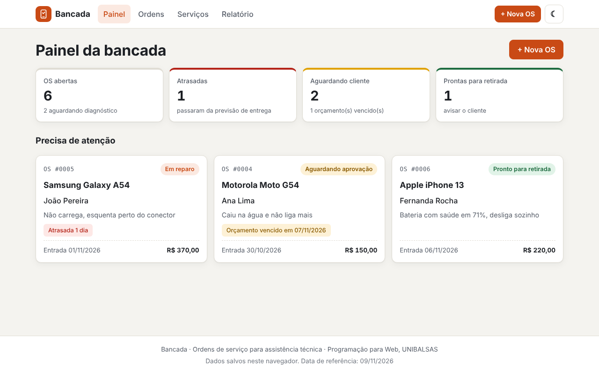

**Ordens** (`/ordens`)
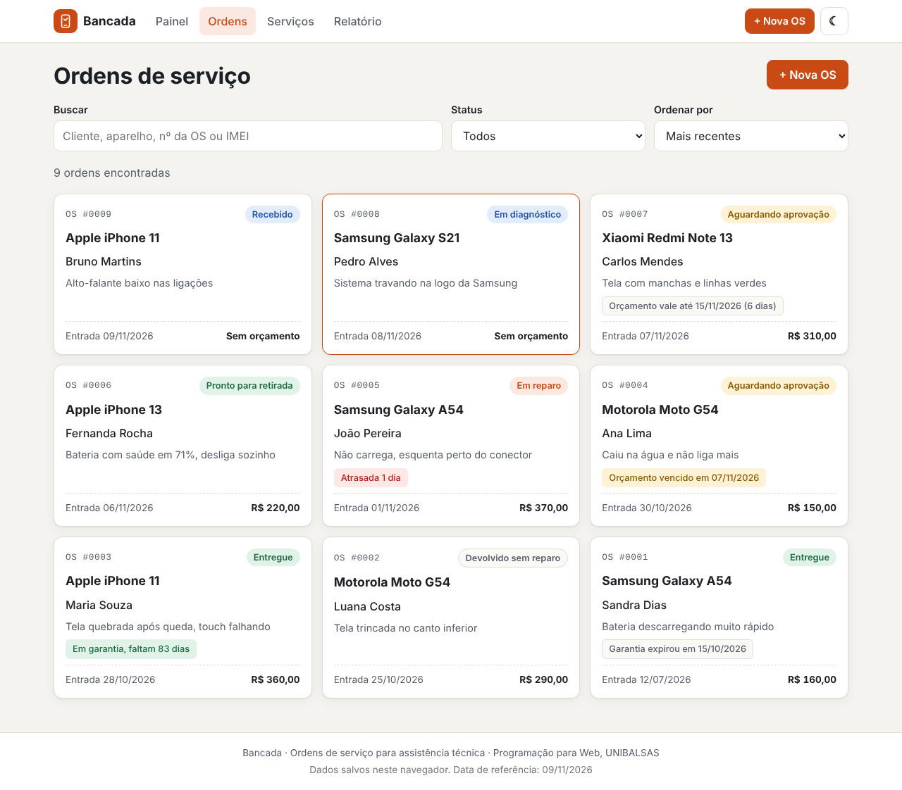

**Nova OS** (`/ordens/nova`), com os erros de validação
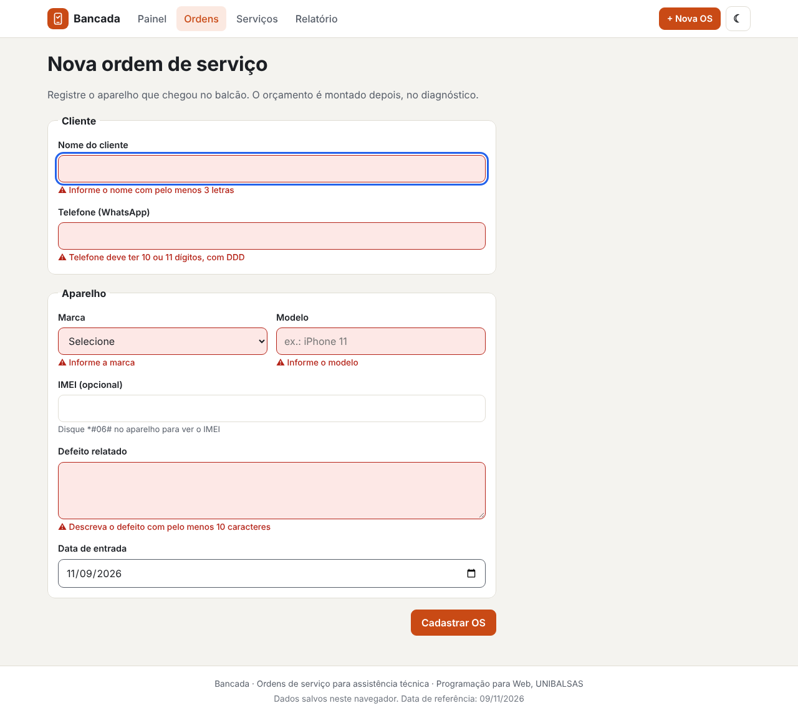

**Detalhe** (`/ordens/:id`), OS atrasada
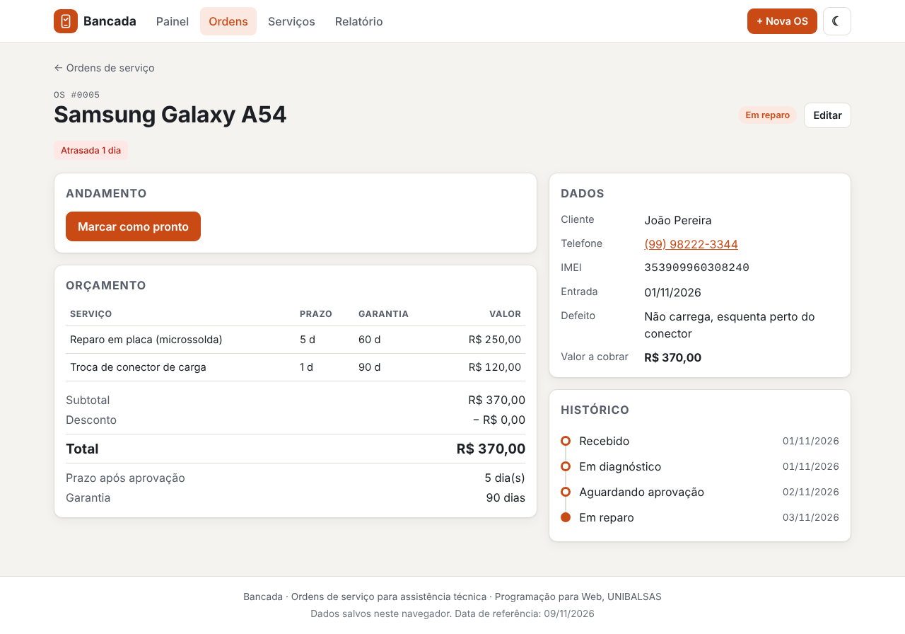

**Orçamento no detalhe**, desconto acima de 10% recusado
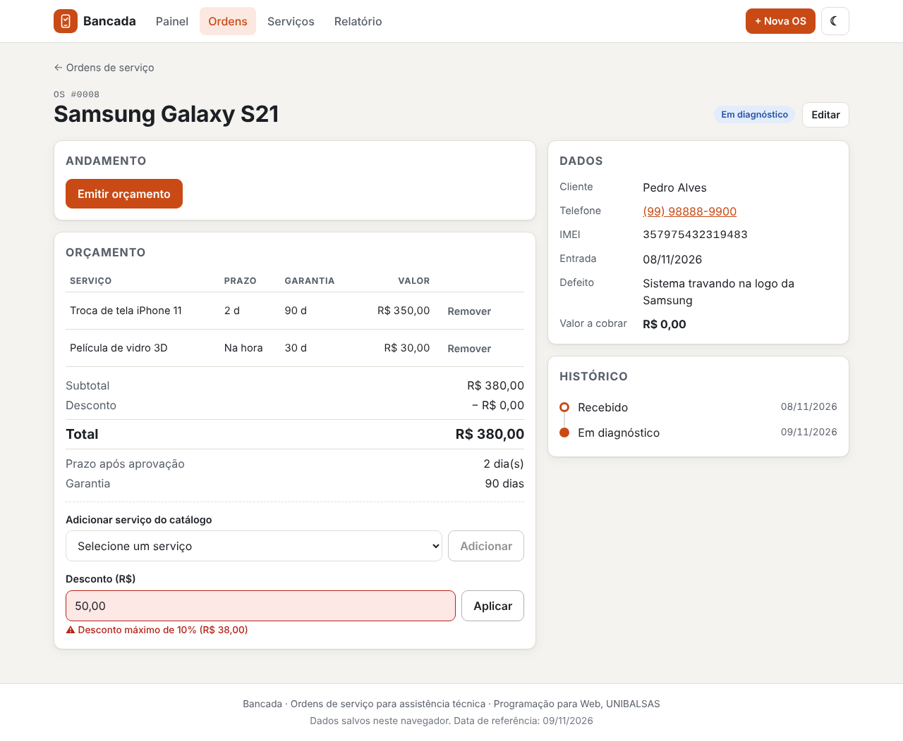

**Editar** (`/ordens/:id/editar`)
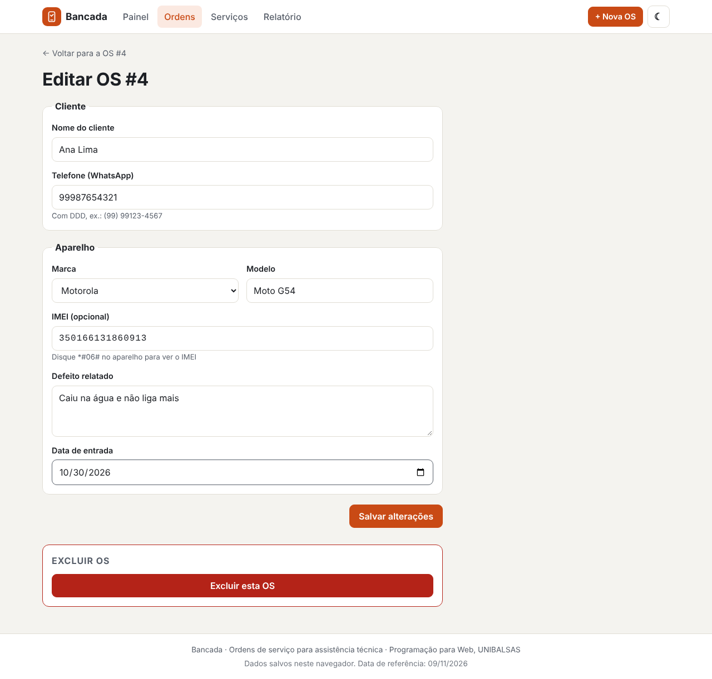

**Serviços** (`/servicos`)
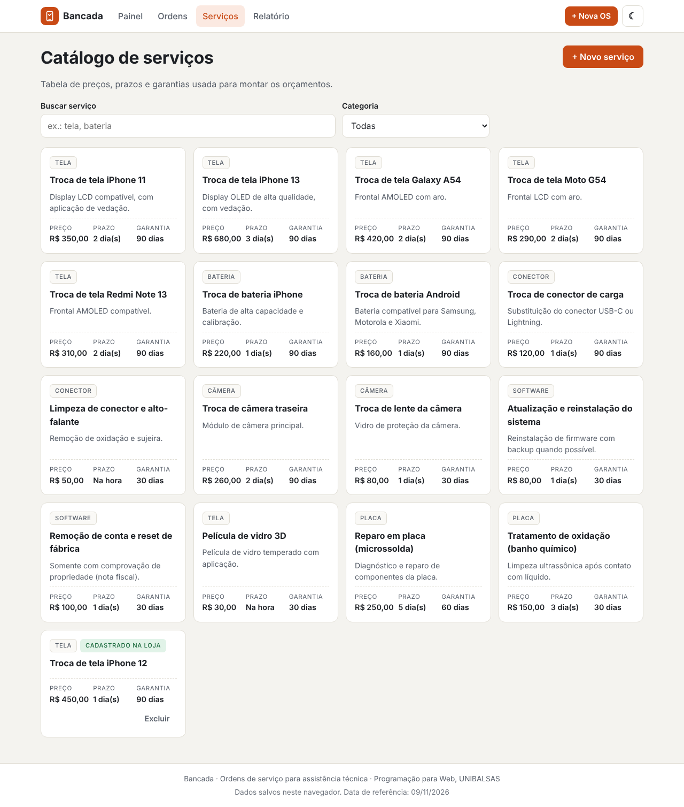

**Novo serviço** (`/servicos/novo`), com os erros de validação
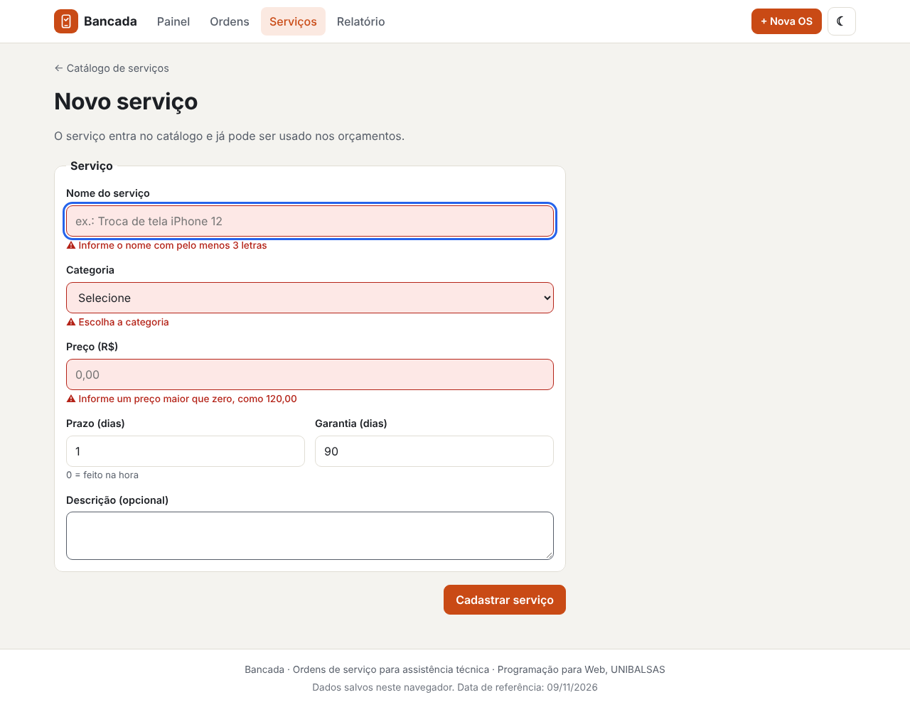

**Relatório** (`/relatorio`)
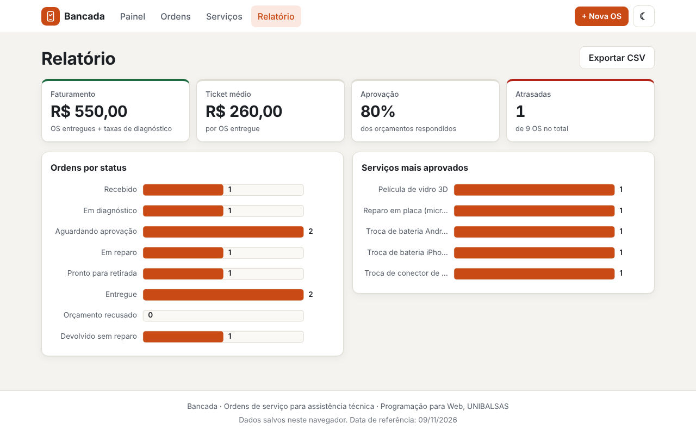

**Não encontrada**
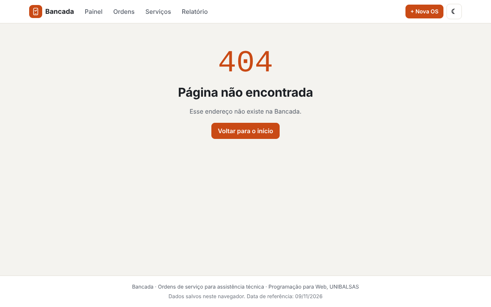

**Erro ao carregar o catálogo**, com *Tentar de novo*
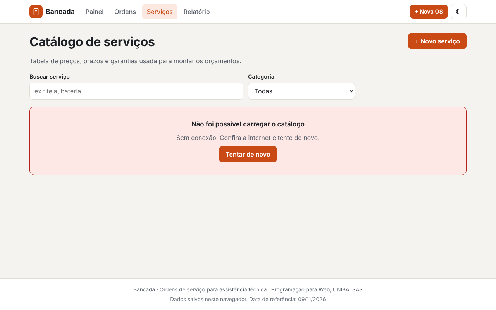

**Modo escuro** e **celular (360 px)**
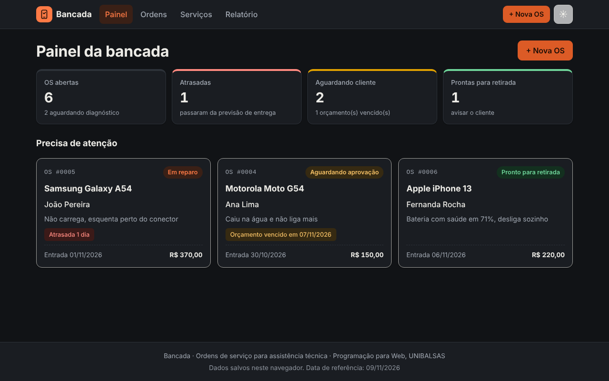
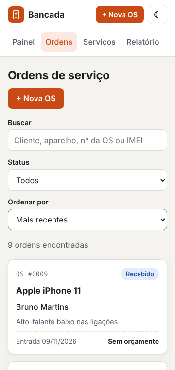

## Regras de negócio

Todas são funções puras em `src/dominio`, sem React e sem `localStorage`. As que dependem da data recebem `hoje` como parâmetro. Testes em `src/dominio/*.test.ts` (28 testes, com "hoje" fixo em 09/11/2026).

| Regra | O que faz | Arquivo |
| --- | --- | --- |
| R1 | IMEI opcional por enquanto (`IMEI_OBRIGATORIO`); quando digitado, 15 dígitos e dígito verificador pelo algoritmo de Luhn | `imei.ts`, `validacao.ts` |
| R2 | Orçamento: subtotal, desconto de no máximo 10%, total | `orcamento.ts` |
| R3 | Orçamento vale 7 dias; vencido não pode ser aprovado, só reemitido | `prazos.ts`, `status.ts` |
| R4 | Previsão de entrega = aprovação + prazo do serviço mais demorado; depois disso, OS atrasada | `prazos.ts` |
| R5 | Garantia conta da entrega, pela maior garantia entre os serviços | `prazos.ts` |
| R6 | Aprovado: cobra o total. Recusado: cobra só a taxa de diagnóstico de R$ 30,00 | `prazos.ts` |
| R7 | Fluxo de status com transições permitidas; emitir exige pelo menos um serviço | `status.ts` |
| R8 | Validação do cadastro e uma só OS aberta por IMEI | `validacao.ts` |
| R9 | Relatório: faturamento, ticket médio, taxa de aprovação, atrasadas, serviços mais feitos e CSV | `relatorio.ts` |
| R10 | Cadastro de serviço: nome único (sem diferenciar maiúsculas), preço maior que zero, prazo de 0 a 60 dias, garantia de 0 a 365 dias | `servicos.ts` |

Datas (`datas.ts`) e dinheiro (`dinheiro.ts`) também têm funções e testes próprios.

### Cenários de aceitação (hoje = 09/11/2026)

| Nº | Situação | Resultado esperado |
| --- | --- | --- |
| S01 | IMEI `490154203237518` | Válido |
| S02 | IMEI `490154203237519` (último dígito trocado) | *IMEI inválido: o dígito verificador não confere* |
| S03 | Tela R$ 350,00 + película R$ 30,00, desconto R$ 20,00 | Total R$ 360,00 |
| S04 | Mesmo orçamento com desconto de R$ 50,00 | Recusado: *Desconto máximo de 10% (R$ 38,00)* |
| S05 | Orçamento emitido em 05/11/2026 | Vale até 12/11/2026, faltam 3 dias |
| S06 | Orçamento emitido em 01/11/2026, cliente aprova | Recusado: *Orçamento vencido em 08/11/2026. Emita um novo orçamento.* |
| S07 | Aprovada em 03/11/2026, serviços com prazo de 2 e 5 dias | Previsão 08/11/2026, *Atrasada 1 dia* |
| S08 | A mesma OS marcada como pronta | Não conta como atrasada |
| S09 | Entregue em 15/08/2026, garantia de 90 dias | Em garantia até 13/11/2026, faltam 4 dias |
| S10 | Entregue em 01/08/2026, garantia de 90 dias | Garantia expirou em 30/10/2026 |
| S11 | Orçamento de R$ 360,00 aprovado | Valor a cobrar R$ 360,00 (sem taxa) |
| S12 | Orçamento recusado | Valor a cobrar R$ 30,00 |
| S13 | Tentar levar de *Recebido* direto para *Pronto* | *Transição inválida: Recebido → Pronto para retirada* |
| S14 | Emitir orçamento sem serviços | *Adicione pelo menos um serviço ao orçamento* |
| S15 | Cadastro com todos os campos corretos | Aceito |
| S16 | Nome "Jo", telefone com 6 dígitos, IMEI inválido, data de amanhã | Erro ao lado de cada um desses 4 campos, foco no nome |
| S17 | Nova OS com IMEI de um aparelho que está na OS #4, em reparo | *Este aparelho já tem uma OS aberta (OS #4)*. Se a OS #4 já foi entregue, aceita |
| S18 | 2 OS entregues (R$ 360 e R$ 350), 1 devolvida e 1 em reparo atrasada | Faturamento R$ 740,00, ticket médio R$ 355,00, aprovação 75%, 1 atrasada |
| S19 | Nova OS sem IMEI | Aceita; o detalhe mostra "Não informado" |
| S20 | Novo serviço "troca de tela IPHONE 11", preço 0, prazo 90 | *Já existe um serviço com esse nome*, *Informe um preço maior que zero*, *Prazo em dias inteiros, de 0 a 60* |

## Decisões técnicas

- **Estado:** dois Contexts: `OrdensProvider` (hook `useOrdens()`) guarda as ordens e `ServicosProvider` (hook `useServicosProprios()`) guarda os serviços cadastrados na loja (`bancada:servicos`), que o `useCatalogo` junta com o JSON. O React é a fonte de verdade e o `localStorage` (`bancada:ordens`) é uma cópia gravada por um `useEffect` que depende de `[ordens]`. A leitura é desconfiada: JSON quebrado ou com formato errado abre a aplicação vazia.
- **Regras fora dos componentes:** as telas só chamam funções de `src/dominio` e mostram o resultado. As regras que podem recusar algo devolvem `Resultado<T>` (`{ ok: true, valor }` ou `{ ok: false, erro }`), uma união discriminada que obriga a tela a tratar o erro.
- **Datas sem fuso:** datas guardadas como `'AAAA-MM-DD'` e contadas com `Date.UTC(ano, mes - 1, dia)`. `new Date('2026-10-01')` seria meia-noite UTC, que em Balsas ainda é o dia anterior.
- **Dinheiro em centavos inteiros**, formatado só na hora de mostrar.
- **Orçamento como fotografia:** o item do orçamento copia preço, prazo e garantia do catálogo. Se o catálogo mudar, a OS antiga mantém o valor combinado com o cliente.
- **Catálogo por `fetch`** de `public/dados/servicos.json`, com espera artificial de 0,6 s para o estado de carregamento aparecer, `AbortController` para cancelar ao sair da tela e "Tentar de novo" que muda a dependência do efeito.
- **HashRouter** para funcionar ao recarregar qualquer rota no GitHub Pages, e `base: './'` no Vite para o mesmo build servir em qualquer hospedagem.
- **Bibliotecas extras:** nenhuma além de `react-router-dom` e `vitest`. CSS puro, gráfico em SVG próprio.
- **Diferenciais:** modo escuro, gráfico em SVG próprio, exportação CSV, filtro de status na URL.
- **O que foi difícil:** fazer o fluxo de status passar sempre pelas regras (cada transição grava datas diferentes) e acertar a contagem de dias sem erro de fuso.

## Créditos

- Catálogo de serviços: JSON próprio em `public/dados/servicos.json`, com preços fictícios. Nenhuma API externa com exigência de atribuição.
- Fontes IBM Plex Sans e IBM Plex Mono, via Google Fonts (licença SIL Open Font License).
